# Chapter 1 Introduction

ProjectPos_2026 is a small supermarket Point-of-Sale application developed for the individual Software Engineering Practice course project. It implements Process Sale and Handle Returns, with supporting product and inventory management. The application records cash sales, calculates exact totals and change, retains receipts, and records refunds while maintaining stock quantities.

## 1.1 Background and objectives

A checkout must keep the quantities sold, the cash received and the stock on hand consistent. Manual calculations can produce incorrect change, while unlinked returns can allow the same purchase to be refunded more than once. The project addresses these problems through validated transactions and a receipt-based return process. A cashier uses English forms and receives a clear explanation when an operation cannot be completed.

The principal academic objective is to connect use-case analysis, domain modeling, layered object-oriented design, implementation and verification. Functional objectives are to manage products, maintain inventory, calculate running totals, accept cash, calculate change, generate receipts, record transactions and process valid returns. Supporting objectives are to preserve actual evidence and use meaningful Git feature branches.

## 1.2 Scope and boundaries

The scope is one local supermarket installation with a trusted cashier. Prices and payments use CNY. Product stock is an aggregate count of interchangeable units. Each return request handles one purchased product line and can be repeated for additional lines. Card-payment integration, separate tax or discount rules, supplier purchasing, user accounts, external accounting and cash-drawer hardware are outside the implementation. Collecting and refunding physical cash and assessing whether goods are resalable remain cashier responsibilities.

## 1.3 Technology and initial inspection

The existing project was inspected before modification. It contained the Spring Boot entry point, Maven configuration, database properties and one context-load test. No business entities, repositories, services, controllers or templates were present, and the directory had no Git repository. The starter was extended in place. The supplied Spring Boot 4.1.1 parent and Java 17 compilation target were retained. Actual verification used Oracle JDK 21, Maven 3.8.5 through the wrapper, Thymeleaf, Spring Web MVC, Jakarta Validation, Spring Data JPA, Hibernate and MySQL 8.0.44. H2 is used only by the default tests.

# Chapter 2 Part 1 Agile Development Process

## 2.1 Individual Scrum adaptation

The project uses an individual adaptation of Scrum: the student maintains an ordered backlog, selects a manageable increment, implements and tests it, reviews the result and adjusts later work. No team members, stand-up meetings or stakeholder approvals are invented. The observed sequence was product and inventory management, cash sale processing, return handling and integration evidence, followed by quizzes and report preparation. Each code increment received actual verification and a preserved feature branch.

A backlog item is verified when its behavior is implemented and supported by an executed test, direct database verification or an inspected document, as appropriate. Writing a file alone is insufficient. The progress chart counts verified items. The items are not assumed to require equal effort and are not represented as story points or hours.

## 2.2 Product backlog and user stories

Table 1 Product backlog

| ID | Epic | User story | Priority | Result |
| --- | --- | --- | --- | --- |
| P01 | Products | As a cashier, I want to create and edit products so prices and barcodes are accurate. | Must | Verified |
| P02 | Inventory | As a cashier, I want to maintain stock and deactivate unavailable products. | Must | Verified |
| P03 | Sales | As a cashier, I want to add and remove cart items before payment. | Must | Verified |
| P04 | Sales | As a cashier, I want an exact running total so I can state the amount due. | Must | Verified |
| P05 | Payments | As a cashier, I want to record sufficient cash to complete the purchase. | Must | Verified |
| P06 | Payments | As a cashier, I want the correct change displayed. | Must | Verified |
| P07 | Receipts | As a customer, I want a receipt preserving the original purchase details. | Must | Verified |
| P08 | Records | As a cashier, I want to review completed transactions. | Must | Verified |
| P09 | Returns | As a cashier, I want to find the receipt before accepting a return. | Must | Verified |
| P10 | Returns | As a customer, I want refunds calculated using the original price. | Must | Verified |
| P11 | Inventory | As a cashier, I want accepted returned units restored to stock. | Must | Verified |
| P12 | Validation | As a cashier, I want invalid transactions rejected with English messages. | Must | Verified |
| P13 | Quality | As a developer, I want repeatable normal, exceptional and concurrency tests. | Must | Verified |
| P14 | Database | As a developer, I want real MySQL integration and table evidence. | Must | Verified |
| P15 | Evidence | As a student, I want genuine browser and database evidence. | Must | Verified |
| P16 | GitHub | As a student, I want preserved Git branches and a confirmed remote repository. | Must | Verified |
| P17 | Quizzes | As a student, I want two complete source-mapped quizzes. | Must | Verified |
| P18 | Report | As a student, I want an editable report tied to actual evidence. | Must | This deliverable |

P05 acceptance requires insufficient cash to leave stock and the sale ledger unchanged. P10 and P11 require an original-price refund, a stock increase and a refund record in one transaction. P12 covers invalid quantities, invalid prices, excessive returns and stale product edits. P16 was verified after all five branch hashes matched their GitHub references; final report verification is recorded separately in the evidence checklist.

## 2.3 Sprint planning and increment records

The assignment suggests three-day or one-week sprints. The following three-day schedule is a planning baseline established on 20 October 2026 for reviewing and completing the coursework. It does not claim that three multi-day sprints have elapsed. Implementation increments were completed in the single recorded session on 20 October; later timeboxes remain proposed review and submission work.

Table 2 Proposed three day timeboxes

| Window | Goal | Status at report preparation |
| --- | --- | --- |
| 20–22 Oct 2026 | Products, sales, returns and technical verification | Code and verification completed on 20 Oct; student review remains. |
| 23–25 Oct 2026 | Review quizzes, UML and report | Documents prepared early; the scheduled review is proposed. |
| 26–28 Oct 2026 | Presentation and video upload | Proposed; GitHub publication was completed early on 20 Oct. |

Table 3 Observed implementation increments

| Increment | Verified output | Evidence |
| --- | --- | --- |
| Product | Product forms, inventory and stale edit checks | 5 passing H2 tests; f716d77 |
| Sale | Cart, totals, cash, change and receipts | 13 passing H2 tests; 5183641 |
| Return | Refunds, restocking and exception handling | 21 passing H2 tests; a1fb0aa |
| Integration | Real database and browser behavior | 21 MySQL tests; 13 browser checks; SQL and screenshots |
| Documents | Quizzes and current technical report | 30 answers, source map, UML and rendered documents |

Development reviews used executable feedback. The offline baseline exposed a missing Maven dependency, one MySQL command failed because PowerShell parsed an unquoted argument, and the first browser test used an unsuitable dropdown selector. Failed attempts remain beside corrected passing runs. These records support adjustment but are not evidence of unrecorded meetings or user acceptance.

## 2.4 Recorded burndown and limitations

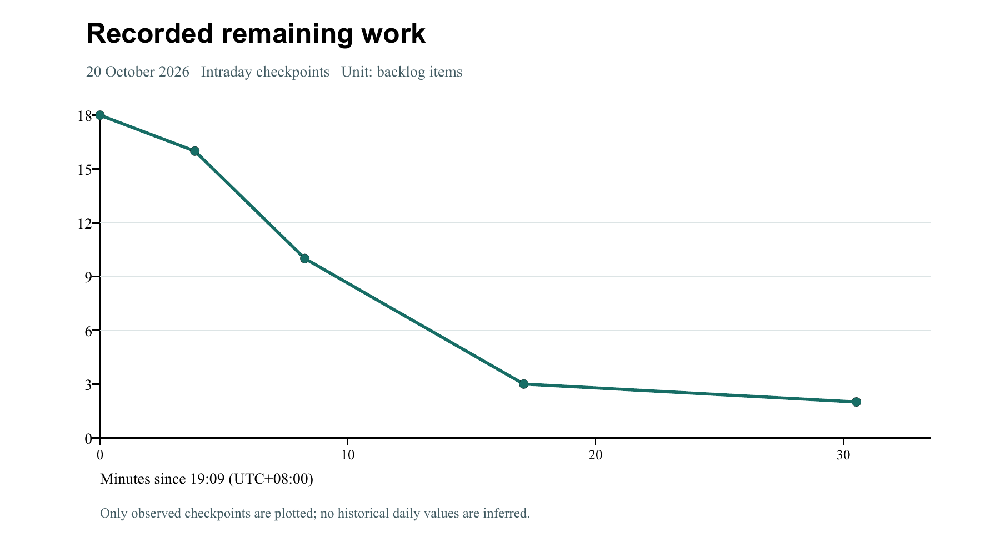

Table 4 Actual progress checkpoints

| Time UTC plus 8 | Verified items | Remaining items |
| --- | --- | --- |
| 19:09:04 | 0 | 18 |
| 19:12:54 | 2 | 16 |
| 19:17:20 | 8 | 10 |
| 19:26:10 | 15 | 3 |
| 19:39:36 | 16 | 2 |

The initial backlog contained 18 items. The chart covers only recorded timestamps from the baseline through quiz verification. Connecting lines do not imply that intermediate completion times were measured. At its cutoff, GitHub completion and the report remained open; this report was prepared afterward. There are no historical daily measurements, completed multi-day burndowns, velocity statistics or effort estimates to reconstruct. The editable CSV and dated log support future observations without invented history.

# Chapter 3 Part 2 Requirements and Use Case Analysis

## 3.1 Functional requirements and business rules

The cashier manages unique barcodes, names, positive unit prices, stock quantities and availability flags. A sale contains one to one hundred products; each requested quantity is between 1 and 10000. Prices have at most two decimal places. Stock lies between zero and one million. Cash must cover the total, and failed checkout records no sale. A receipt retains its original names and prices after catalog changes.

Returns require a completed sale and a matching purchased line. Quantity must be positive and cannot exceed the purchased quantity minus all previous returns. A reason of one to two hundred characters is required. Refunds use the unit price captured in SaleItem. Sales reduce stock; accepted returns increase it without exceeding the inventory limit. Persisted request keys prevent another sale or refund for a repeated completed request.

## 3.2 Use case context

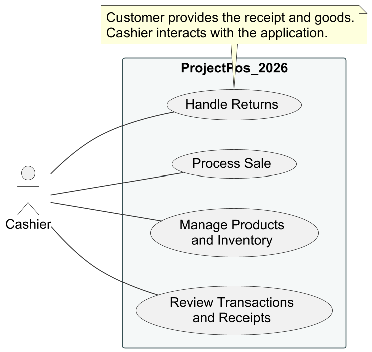

The customer participates in the business process by providing goods, cash and a receipt for returns. The cashier operates the software. Product management and transaction review support the required core use cases. The boundary includes the local database; no external card, accounting or inventory service is presented as implemented.

## 3.3 Fully dressed use case UC1 Process Sale

Scope: ProjectPos_2026. Level: user goal. Primary actor: Cashier. Trigger: a customer presents goods. Stakeholders: the cashier needs correct totals and change; the customer needs accurate charges and proof of purchase; the store needs consistent stock and an auditable record.

Preconditions: the application and database are available and the catalog contains the purchased products. The cashier has access to the trusted local installation. Authentication is not implemented. Minimal guarantee: failed checkout creates no sale and does not reduce stock. Success guarantee: one paid sale and its snapshots are saved, stock is reduced, cash and change are recorded, and a receipt is displayed.

- 1. The customer arrives at checkout with products.

- 2. The cashier opens New sale and selects a product and quantity.

- 3. The system checks the cart quantity and displays item details and the running total.

- 4. The cashier repeats entry, removing an item or clearing the cart if needed.

- 5. The cashier states the total, collects cash and enters the amount received.

- 6. The system locks products in a consistent order and revalidates availability, quantities, stock and cash.

- 7. The system records payment, persists the sale and snapshots, and deducts stock in one transaction.

- 8. The receipt and change are displayed. The cashier provides the receipt and change, and the customer leaves with the goods.

Extensions: unknown or inactive products are rejected. Insufficient stock or payment produces an English message and retains the cart for correction. Invalid numbers are rejected. Checkout uses current locked product information if the catalog changes. Database failures roll back the transaction. A stale browser checkout form is rejected, and a repeated service checkout key returns the existing sale. The saved receipt can be printed again without another sale.

Special requirements: exact decimal money, historical line snapshots and English UI messages. Technology/data variations: web-form entry and browser printing or Save as PDF. Frequency: repeated per customer, with no measured throughput asserted. Open issues: authentication and dedicated receipt-printer integration.

## 3.4 Fully dressed use case UC2 Handle Returns

Scope: ProjectPos_2026. Level: user goal. Primary actor: Cashier. Trigger: a customer presents purchased goods and the sale reference. Stakeholders: the customer needs a correct refund; the store needs to prevent excessive or duplicate refunds and maintain stock; the cashier needs the remaining returnable quantity.

Preconditions: the application and database are available and the sale is completed. The cashier determines whether the goods can return to stock. Minimal guarantee: an invalid return changes neither stock nor refund records. Success guarantee: a return record is saved, the line’s returned quantity increases, stock is restored and the refund is displayed.

- 1. The cashier opens Transactions and returns and enters the sale number or chooses a receipt.

- 2. The system displays original items, prices, purchased quantities and quantities still returnable.

- 3. The cashier selects one purchased line and enters the return quantity and reason.

- 4. The system locks the line, checks receipt ownership and verifies the remaining quantity.

- 5. The product is locked and refund = original unit price x accepted quantity is calculated.

- 6. The system restores stock, updates returned quantity and saves the refund in one transaction.

- 7. The updated receipt and refund are displayed. The cashier provides the cash refund.

- 8. The process can be repeated for another purchased line.

Extensions: unknown receipts and items belonging to another receipt are rejected. Zero, negative, excessive and cumulatively excessive quantities, missing reasons, invalid tokens and inventory overflow are rejected. Concurrent attempts to return the same last unit are serialized by the line lock. Reusing a completed return key returns the saved refund without another stock increase. A database failure rolls back all return changes.

Special requirements: use the original price even after renaming, repricing or deactivation. Technology/data variations: one product line per submission, with cash refunds only. Frequency: occasional relative to sales; no actual rate is asserted. Open issues: damaged-goods policy, return deadlines and managerial approvals.

## 3.5 System sequence diagrams

The SSDs treat the application as a black box. Their operation names express cashier intent and are not claims that identically named Java methods exist. Internal collaborations appear in Chapter 6.

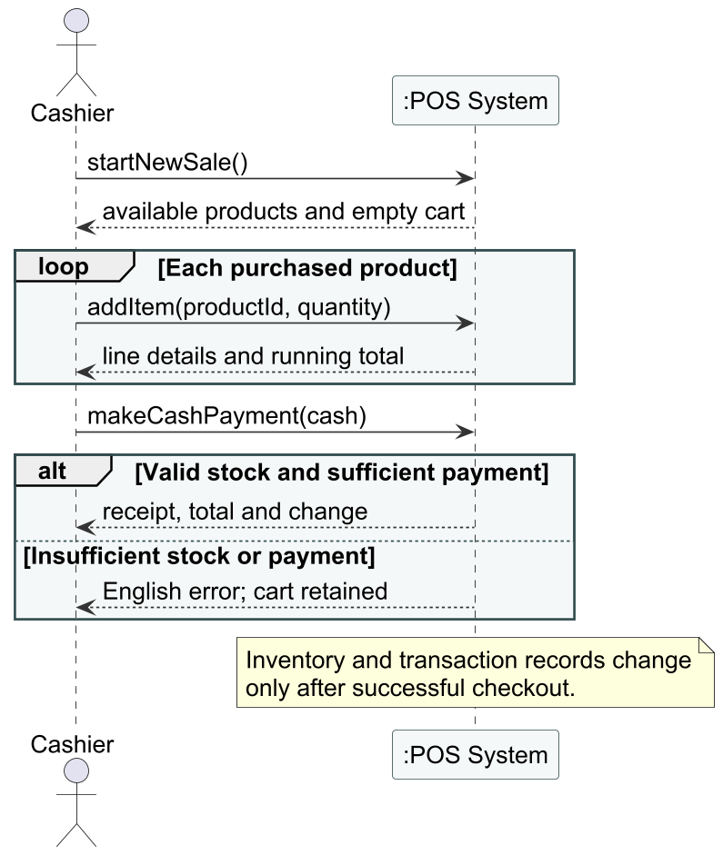

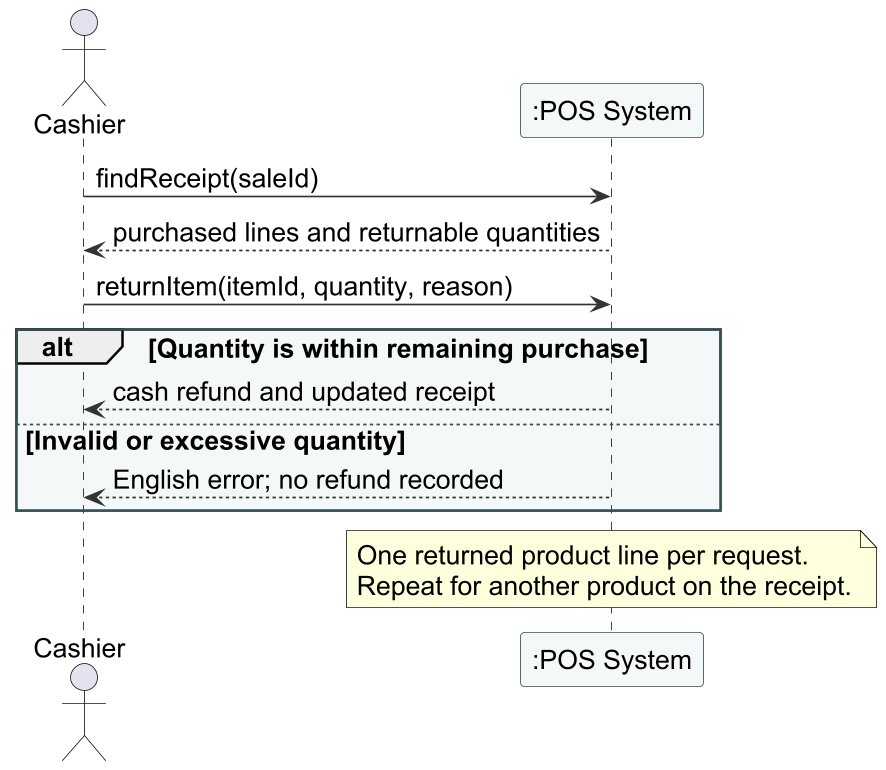

# Chapter 4 Domain Model

## 4.1 Conceptual classes

The model identifies four business concepts. Product describes a catalog item and its aggregate available quantity. Sale represents a completed cash purchase. SaleItem represents a product quantity and historical unit price within a sale. ReturnRecord represents an accepted return against a purchased line, with quantity, refund, reason and time. These concepts follow the use-case vocabulary and remain distinct from technical controller and repository classes.

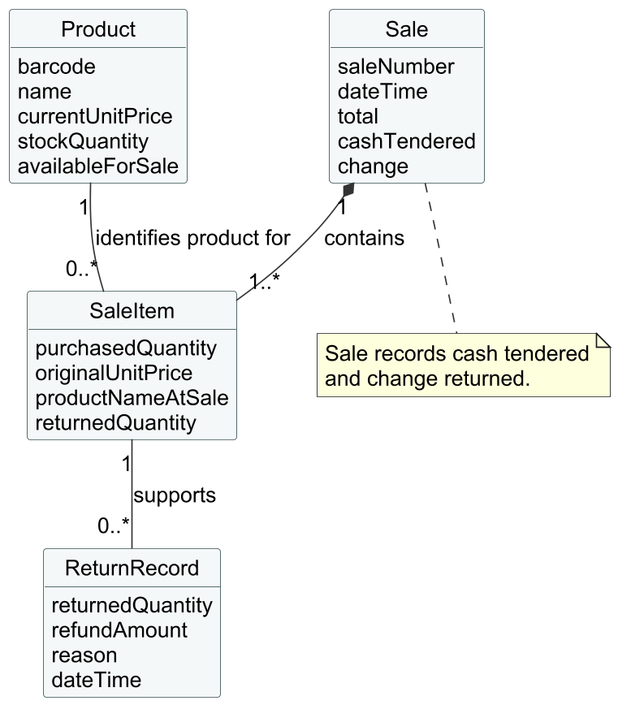

## 4.2 Associations and interpretation

Each completed Sale contains one or more SaleItems, and each SaleItem belongs to exactly one Sale. A Product can be referenced by zero or many sale items; every sale item identifies one product. A SaleItem supports zero or many ReturnRecords, and each return record belongs to one purchased line. An additional arithmetic invariant requires total returned quantity not to exceed purchased quantity; multiplicity alone cannot express it.

Cash payment is represented by Sale attributes rather than a separate Payment entity. Stock is a quantity on Product instead of a separate inventory subsystem or one object per physical unit. These choices keep the course application simple. The conceptual diagram excludes JPA identifiers, repositories and Java method signatures; those appear in the design diagrams.

# Chapter 5 Logical Architecture

## 5.1 MVC and responsibility boundaries

Spring MVC separates presentation from business use cases. Thymeleaf templates present data and submit forms. Controllers bind requests, manage page flow and the session cart, and delegate to services. Services define business operations and transaction boundaries. Repositories provide persistence queries and locks through Spring Data JPA. Entities hold persistent state and related domain behavior. BusinessException resides in a shared exception package, so entities do not depend on services.

This is relaxed layering: controllers read entity data obtained through services for rendering, and services use repositories and entities. Lower layers do not reference web controllers or templates. The diagram reflects actual dependencies instead of imposing a strict rule that source code does not follow.

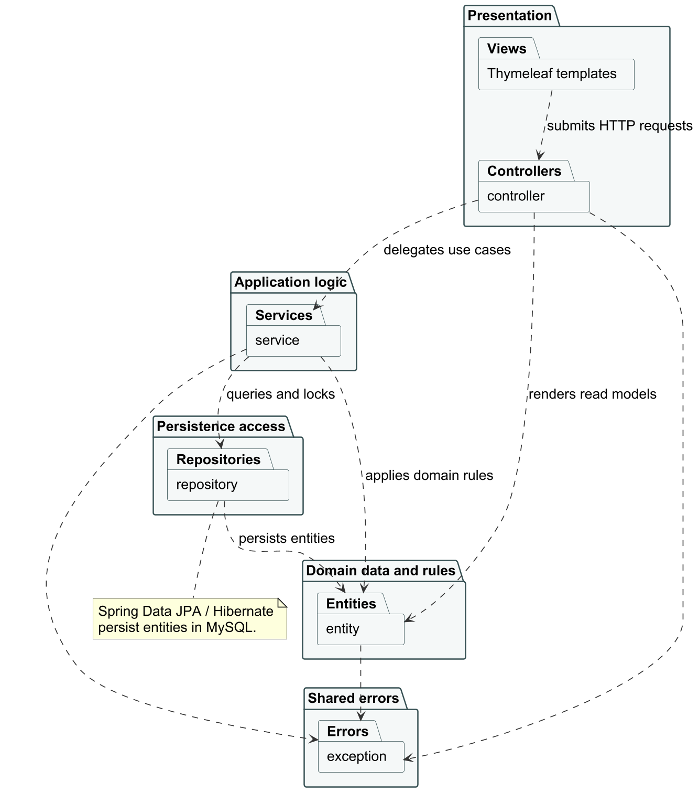

## 5.2 Architectural rationale

Refund and inventory rules can be tested without web-page interaction. Changing layout does not require changing stock deduction, and persistence queries are not duplicated in templates. Constructor injection makes dependencies explicit. The architecture deliberately avoids separately deployed services, message brokers and a custom persistence framework.

SaleService and ReturnService coordinate business use cases; Spring MVC controllers manage presentation flow. This respects the course distinction between web MVC and GRASP controllers. Disabling open-in-view requires detailed sale queries to load the items needed before rendering a receipt. The design remains understandable without hiding business transactions behind unnecessary abstractions.

# Chapter 6 Object Oriented Design

## 6.1 Classes and responsibilities

Table 5 Important design responsibilities

| Class | Responsibility and key behavior |
| --- | --- |
| Product | Validate catalog values; decreaseStock and restoreStock enforce stock rules; version detects stale edits. |
| Sale | Own sale items, add subtotals, record cash/change and derive the refunded total. |
| SaleItem | Retain original name, barcode and price; calculate subtotal and remaining returnable quantity. |
| ReturnRecord | Retain accepted quantity, original-price refund, reason and timestamp. |
| ShoppingCart | Store product IDs, quantities and checkout key in the session, without managed JPA entities. |
| ProductService | Create products and serialize edits using version and barcode checks. |
| SaleService | Preview a cart and revalidate/persist a cash checkout atomically. |
| ReturnService | Validate receipt ownership and quantities; refund and restore stock atomically. |
| Controllers | Bind forms, delegate business work and render or redirect English pages. |
| Repositories | Find/persist entities and acquire pessimistic locks for contested quantities. |

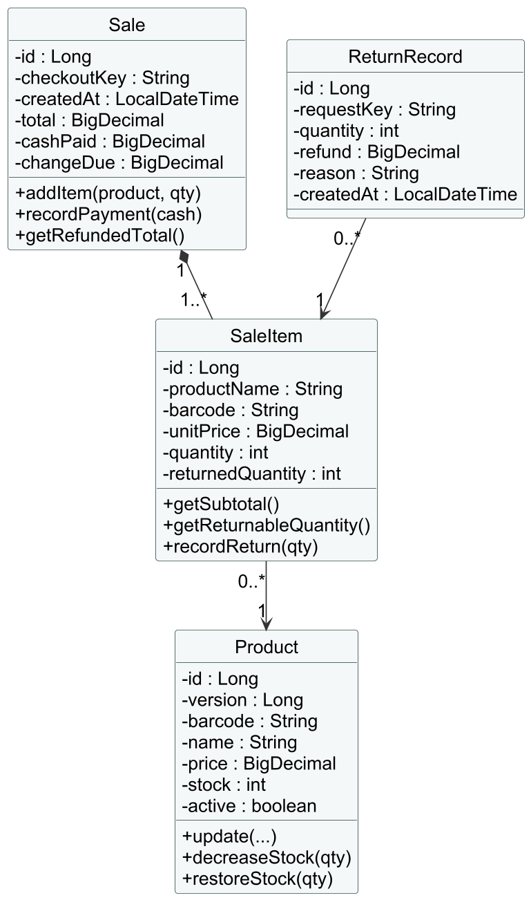

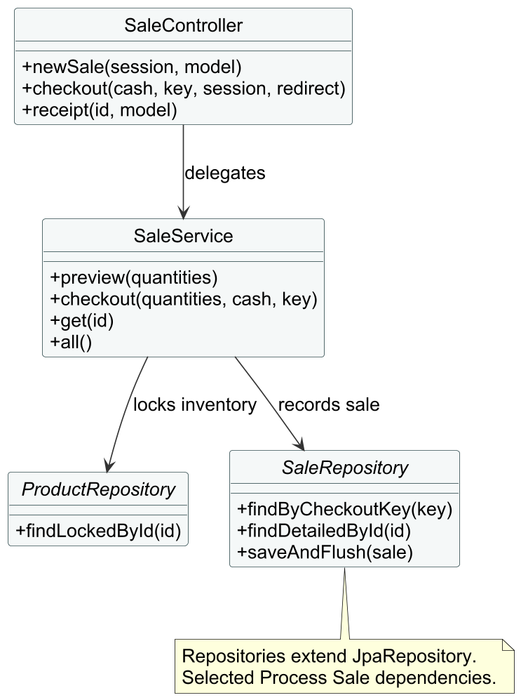

## 6.2 Interaction diagrams

SaleController enters the transactional checkout service. Product rows are locked in sorted ID order, reducing deadlock risk for carts containing the same products in different orders. The service checks for an existing checkout key before another transaction is recorded. Sale creates its SaleItems, payment is recorded and stock is reduced before the aggregate is flushed.

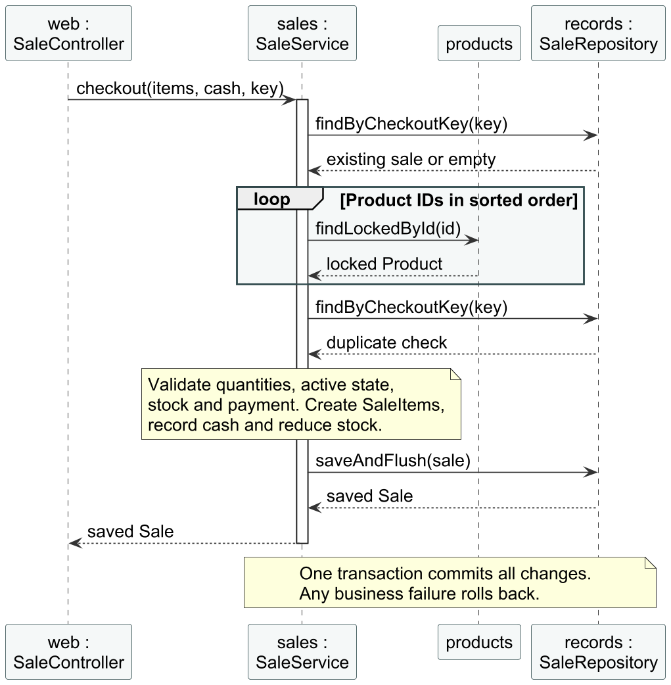

Returns use a locked SaleItem to serialize competing requests. After obtaining the lock, ReturnService rechecks the request key, validates remaining quantity, locks the product, restores stock and saves a ReturnRecord. In the diagram, web = ReturnController, returns = ReturnService, items = SaleItemRepository, products = ProductRepository and records = ReturnRepository. Short object-role labels keep the interaction readable.

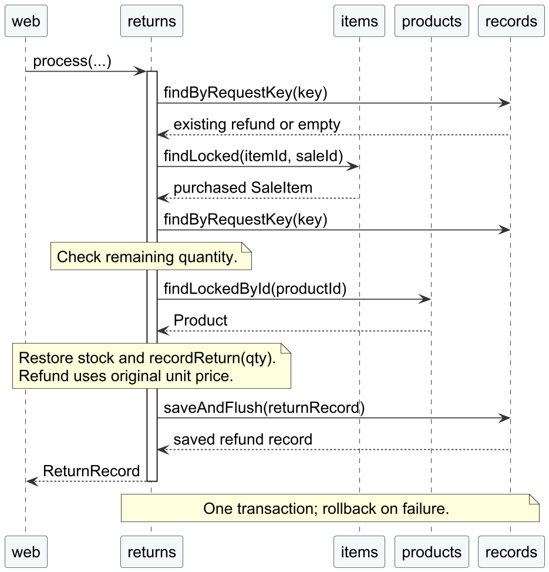

## 6.3 Responsibility assignment and design decisions

Information Expert appears in SaleItem.getSubtotal, which knows both price and quantity, and Sale.getRefundedTotal, which knows its purchased lines. Creator appears in Sale.addItem, which creates the SaleItems it contains. Use-case coordination belongs to services, while web controllers delegate business work. These assignments support cohesion and a small gap between business concepts and code.

No custom Factory or Adapter pattern is claimed: there are no interchangeable third-party tax or payment providers requiring them. Framework object creation does not establish a student-authored GoF factory. Tests were added and executed with increments, but evidence does not establish a historical test-first red/green/refactor sequence, so strict TDD practice is not asserted.

Pessimistic locks protect current stock and returnable quantities inside transactions. Product’s JPA version and the submitted form version address a different problem: preventing an old editing page from overwriting a later stock change. Both mechanisms can be explained directly in a course defense.

# Chapter 7 Implementation

## 7.1 Configuration and persistence

Maven retains the supplied Spring Boot parent and adds H2 only in test scope. Runtime dependencies provide Web MVC, validation, Thymeleaf, Spring Data JPA and MySQL Connector/J. The application targets pos_2026_db on localhost:3306. DB_PASSWORD supplies the password; the original plaintext credential was removed before the first commit. The example environment file contains placeholders. Maven 3.8.5 was executed through the wrapper.

Hibernate update mode creates missing tables. The verified schema contains products, sales, sale_items and return_records, all using InnoDB. Sale cascades persistence to its items. Products are deactivated rather than deleted, retaining references for sales and returns. SaleItem snapshots preserve the purchase even after catalog changes.

## 7.2 Product management and inventory

ProductForm provides declarative constraints and English field messages. ProductService also invokes domain validation so rules do not rely on the browser. A database constraint protects barcode uniqueness. Editing locks the row and compares the form’s version to the current version before changing name, price, stock or active status. An outdated editing form must be reloaded after another transaction changes the product.

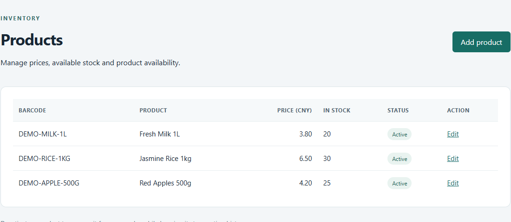

## 7.3 Cash sale and receipt generation

ShoppingCart combines repeated quantities and checks available stock. SaleService.preview obtains product information for the running total. Checkout rechecks an empty cart, invalid quantities, inactive/missing products, insufficient stock, invalid decimal cash and insufficient payment. BigDecimal avoids binary floating-point errors, including the 0.10 multiplied by three scenario verified in tests.

Total is the sum of unit price multiplied by quantity, and change is cash paid minus total. Cash and total are capped at CNY 999999999.99. Successful checkout saves the sale and historical lines and deducts stock together, then redirects to a saved receipt and clears the cart. A stale browser key is rejected; a unique persisted key also prevents duplicate service checkout.

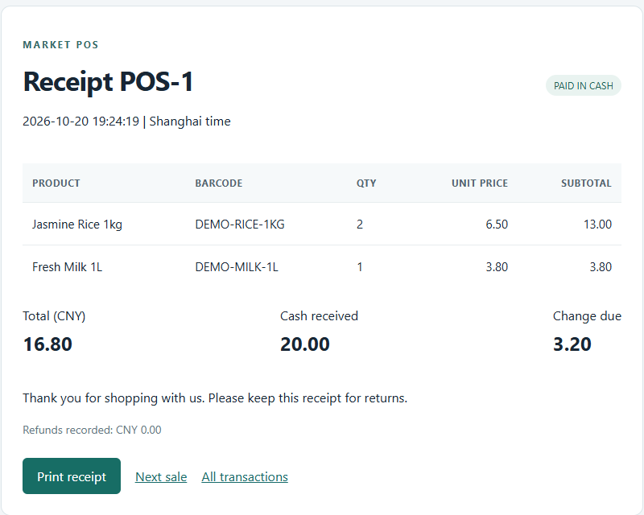

## 7.4 Return processing and error handling

A cashier finds a receipt, selects its purchased line and enters quantity and reason. ReturnService checks ownership and cumulative remaining quantity. Refund is original sale price multiplied by accepted quantity, even after repricing or deactivation. It restores stock, increments returnedQuantity and saves ReturnRecord in one transaction. The page displays the refund and separate return history.

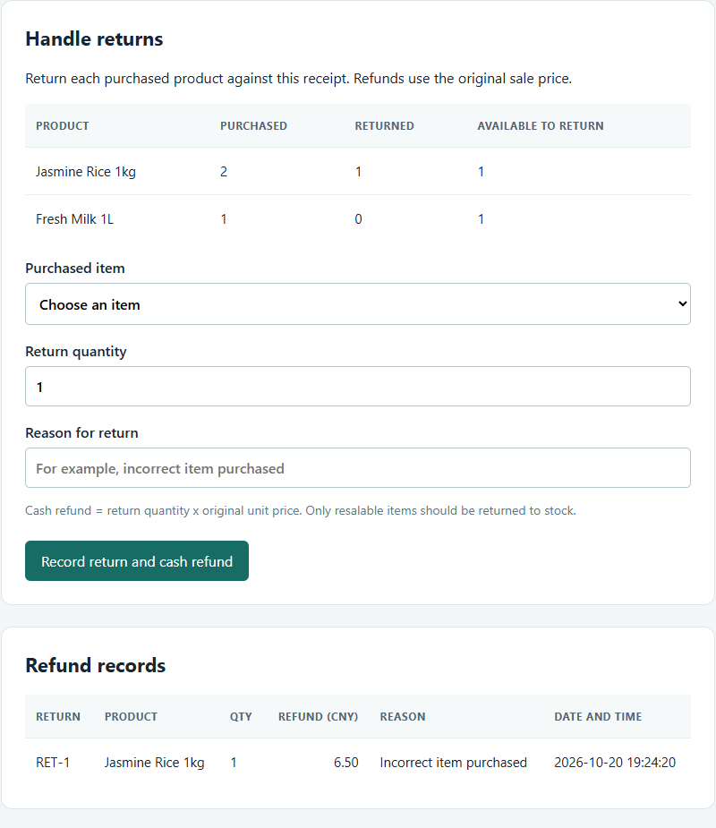

Controller advice renders business and binding errors in English; product errors remain beside their fields. A fixed English locale avoids system-language messages. Each changing POST carries a session CSRF token checked by an interceptor. Database errors produce a friendly conflict page. This is a trusted localhost demonstration; account authentication and permission management remain future work.

# Chapter 8 Testing and Results

## 8.1 Actual environment and test separation

Verification ran on Windows 11 with Oracle JDK 21 and the Maven wrapper. Default tests use H2 in MySQL compatibility mode. The separate mysql-test profile runs the same service tests against real pos_2026_test_db, avoiding automated writes to the application’s pos_2026_db. Browser verification exercised the running application on 127.0.0.1:8080 against the application database. Clearly labeled DEMO products and their genuine sale/refund records remain for inspection.

Table 6 Executed build and integration results

| Execution | Observed result | Evidence in docs/evidence |
| --- | --- | --- |
| Baseline offline clean test | Failed on uncached Surefire dependency; compilation completed | 2026-10-20-baseline-maven-test.log |
| Product increment | 5 tests, zero failures/errors/skips | 2026-10-20-products-final-test.log |
| Sale clean test | 13 tests, zero failures/errors/skips | 2026-10-20-sales-test.log |
| Complete clean test H2 | 21 tests, zero failures/errors/skips | 2026-10-20-returns-test.log |
| MySQL test profile | 21 tests, zero failures/errors/skips | 2026-10-20-mysql-integration-retry.log |
| Clean package | BUILD SUCCESS; 21 passing tests; runnable JAR created | 2026-10-20-clean-package.log |
| spring-boot:run | Started on port 8080 and identified MySQL 8.0.44 | 2026-10-20-application-run.log |
| Browser verification | 13 checks passed; no JavaScript page errors | live-http-results.json |

The 21 tests comprise one context test, four product tests, eight sale tests, six return tests and two concurrency tests. Running them on two databases does not produce 42 distinct scenarios. Build success is not proof of every production behavior; the functional results below define the scope of verification.

## 8.2 Functional and exceptional scenarios

Table 7 Verified business scenarios

| Scenario | Expected result | Observed result |
| --- | --- | --- |
| Multi-product sale | 2 rice at 6.50 plus 1 milk at 3.80 totals 16.80 | POS-1 saved with total 16.80. |
| Change | 20.00 cash minus 16.80 total | Receipt shows 3.20 change. |
| Insufficient stock | Reject 10000 units without cart acceptance | English error; screenshot 02. |
| Insufficient payment | Reject 16.79 for the 16.80 cart | English error; cart retained; screenshot 04. |
| Failed checkout | No new sale or inventory reduction | Service assertions passed. |
| Excessive return | Reject 3 units against 2 purchased | English error; screenshot 06. |
| Partial refund | Refund 1 rice unit at original 6.50 | RET-1 records refund 6.50. |
| Inventory | Rice 30 - 2 + 1 = 29; milk 20 - 1 = 19 | SQL and product page confirm 29 and 19. |
| Cumulative over-return | Reject quantities beyond the remaining purchase | Automated assertions passed. |
| Historical price | Use 2.35 after catalog price becomes 9.00 | Two-unit refund verified as 4.70. |
| Duplicate request | No second refund or restock with the same key | Service and live checks passed. |
| Concurrency | Only one request consumes or refunds the last unit | Two-thread tests passed on H2 and MySQL. |
| Forms and CSRF | Reject invalid values and missing token | English errors; missing token returned HTTP 403. |
| Receipt lookup | Find saved receipt; reject malformed/unknown IDs | Lookup passed; invalid requests returned HTTP 400. |

## 8.3 Real database evidence

Direct mysql queries verified MySQL 8.0.44, pos_2026_db and four InnoDB tables. The saved sale has total 16.80, cash_paid 20.00 and change_due 3.20. Its rice line has quantity 2 and returned_quantity 1; milk has quantity 1 and returned_quantity 0. RET-1 references the rice line, with quantity 1 and refund 6.50. Product stock is rice 29, milk 19 and apples 25. These are saved demo records, not mocked query output.

Results are retained in 2026-10-20-database-final-verification.log. Baseline SQL establishes that the schema already existed but had no tables. The initial sandboxed connection was denied by the environment; the authorized retry connected successfully. An unexecuted or failed check is not reported as a pass.

## 8.4 Corrections and verification limits

The offline baseline lacked a Surefire dependency. The wrapper was aligned with available Maven 3.8.5, dependencies were downloaded and later tests/package passed. PowerShell split the first unquoted MySQL profile argument; the quoted retry passed. A dropdown locator caused the initial browser timeout; selecting the observed select element corrected the test. Escaped line labels were corrected before the final successful PlantUML render.

Windows held an active server log open during a branch change. The POS server was stopped briefly, its active log was retained and the verified branch was merged. The packaged document renderer could not find LibreOffice in the Windows runtime. Installed Microsoft Word successfully exported the documents, and their PDF pages were rasterized for visual inspection.

Passed: the executed automated suites, packaging, SQL, listed browser checks and subsequent GitHub publication. Initial local Git authentication failed; the student signed into GitHub Desktop, which successfully pushed the branches. Pending: demonstration video upload and URL. Not executed: load testing, long-duration reliability testing, penetration testing, hardware printing/cash-drawer tests and external payment integrations. No coverage percentage or unmeasured performance result is claimed.

# Chapter 9 Git and GitHub Version Control

## 9.1 Initial state and individual authorship

Initial status, branch, remote and log commands reported that the directory was not a Git repository. No earlier local history was available there. Git was initialized on 20 October 2026 after credentials were removed from tracked configuration, and the sanitized starter became the baseline. Commits use the student’s existing configured Git identity. This is individual development; no collaborators are invented.

The student created and supplied https://github.com/0ShaoYifei/ProjectPos_2026 under the verified account 0ShaoYifei. Remote inspection found initial README commit 3e6c025. This history was fetched and merged into local main as 8cb0771 without rewriting either root history. An initial command-line push dry run failed authentication. After the student signed into GitHub Desktop, its Publish branch operation successfully uploaded main and all four feature branches. A subsequent git ls-remote --heads origin confirmed that each remote hash matched its local branch.

## 9.2 Preserved branches and merges

Table 8 Preserved implementation history

| Branch | Commit evidence | State |
| --- | --- | --- |
| main | 9f3d709, d129a15, a570cfb, 8cb0771 | Contains verified implementation and preserved remote initial history. |
| feature/product-management | f716d77; 9f587a0 | Preserved and merged with a merge commit. |
| feature/process-sale | 5183641 | Preserved and merged with a merge commit. |
| feature/handle-returns | a1fb0aa | Preserved and merged with a merge commit. |
| feature/documentation | Current documents and evidence | Preserved; final delivery log records its merge. |

Commit messages describe concrete increments. Product work adds catalog and stock validation; the sale commit adds atomic cash checkout and receipts; the return commit adds audited refunds and real database/browser evidence. Merge commits preserve these boundaries. Branches have not been deleted, and there has been no force push or history rewriting.

## 9.3 Genuine command evidence and remote handoff

Command journals contain actual commands and exit codes. The first journal includes a failed checkout caused by its own tracked log changing. The active journal was subsequently kept in ignored storage and snapshotted into evidence. A later active-server file-lock failure is also recorded. The branch and graph listings are direct Git output, not reconstructed history.

```text
git init -b main
git switch -c feature/product-management
git commit -m "feat: manage products and inventory with validation and stale edit protection"
git merge --no-ff feature/product-management ...
git switch -c feature/process-sale
git merge --no-ff feature/process-sale ...
git switch -c feature/handle-returns
git merge --no-ff feature/handle-returns ...
```

These abbreviated commands summarize executed actions. Full commands and results appear in git-commands.log and git-session-record.log. Publishing through GitHub Desktop is documented separately as a UI action, rather than presented as a terminal push command. The public repository was opened successfully with HTTP 200, and its screenshot was captured after the initial publication. Subsequent documentation commits and their merge are recorded in the final delivery log. Course references, local credentials, temporary files and personalized submission binaries are excluded from the public source repository.

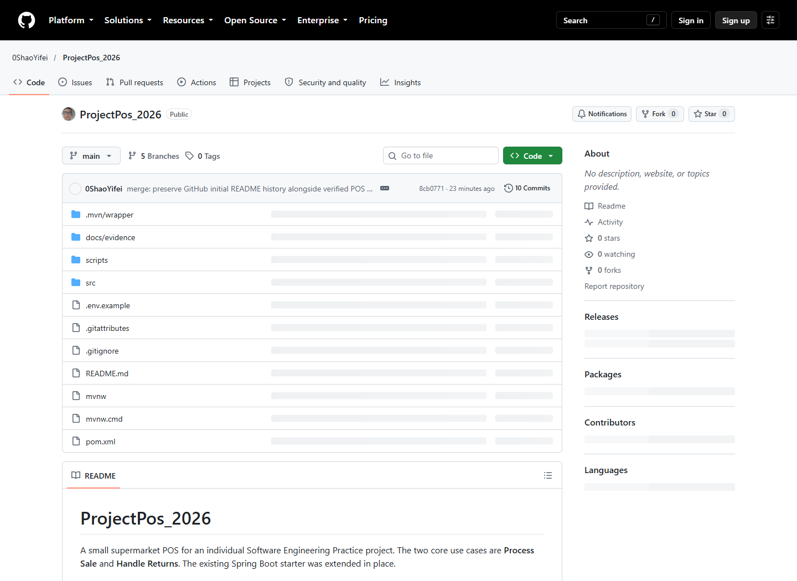

# Chapter 10 Conclusion

The application supports both required use cases with catalog management, exact cash calculations, receipts, transaction records, validated refunds and consistent inventory updates. Business concepts map to focused Java entities, transactional services and explicit persistence queries. Actual tests demonstrate normal, invalid and contested operations on H2 and real MySQL; browser and SQL evidence confirms the running system’s behavior.

Incremental work exposed failures at manageable stages. Product rules were verified before checkout, and checkout before refunds and concurrent access. Dated records and retained failures support a defensible account of this work. Progress measurements cover one session, so they do not establish multi-day Scrum velocity or earlier sprint performance.

Limitations include trusted local deployment, no authentication, no separate tax/discount or card subsystem, and a simple policy returning accepted goods to stock. Future work can add roles, damaged-goods handling, deadlines, pagination, migration-controlled schema changes and hardware receipt support. The verified application and preserved branches have been published to GitHub. Remaining coursework submission work is to prepare and review the presentation/video, upload the genuine demonstration and replace the pending video link before submission.

# Appendix A Source and Evidence Index

Authoritative specification: references/Software Engineering Practice Assignment.docx. Cover basis: references/Tech Report Cover Page (3).docx. Conceptual reference: Craig Larman, Applying UML and Patterns, third edition, especially chapters 6, 9, 10, 13, 15, 17, 19, 21 and 26. The previous robot report informed organization and, at the student’s explicit direction, identity fields. Its project results, dates, Git commands and progress are not POS evidence.

Table 9 Submission and evidence files

| Location | Contents |
| --- | --- |
| README.md | Setup, configuration, supported behavior and test instructions. |
| src/main and src/test | Actual implementation and 21 automated tests. |
| docs/evidence | Successful and failed logs, SQL, browser results, screenshots and dated development records. |
| docs/product-backlog.csv | Editable backlog of 18 tracked items. |
| report_assets/burndown_data.csv | Actual measurements frozen at report preparation. |
| report_assets/*.puml, *.png, *.svg | Editable UML sources and rendered diagrams. |
| screenshot-provenance.json | Original screenshot paths, hashes and unaltered crop coordinates. |
| deliverables/quizzes | Both quizzes in Word/PDF and question-to-source mapping. |
| report_evidence_checklist.md | Verification checks and outstanding external submission items. |

## A.1 Actual implementation excerpts

The following excerpts are taken from the implementation; surrounding statements are omitted for clarity.

```text
// SaleService.checkout
if (cash.compareTo(sale.getTotal()) < 0)
    throw new BusinessException("Insufficient payment. Cash must cover the sale total.");
sale.recordPayment(cash);
locked.forEach((id, product) -> product.decreaseStock(quantities.get(id)));
return sales.saveAndFlush(sale);

// ReturnService.process
product.restoreStock(quantity);
item.recordReturn(quantity);
return returns.saveAndFlush(new ReturnRecord(requestKey, item, quantity, reason));
```

## A.2 Demonstration and external submission fields

POS repository URL: https://github.com/0ShaoYifei/ProjectPos_2026. Demonstration video URL: [Pending upload]. The repository address is confirmed; replace the video placeholder with a genuine uploaded demonstration link. The earlier project video is not a substitute. A demonstration should combine slides and the working system: a cash sale and change, insufficient stock/payment, a valid refund, excessive-return rejection, database records and Git history. The assignment requires a presentation and Bilibili upload; this report does not claim those external submissions have already occurred.
